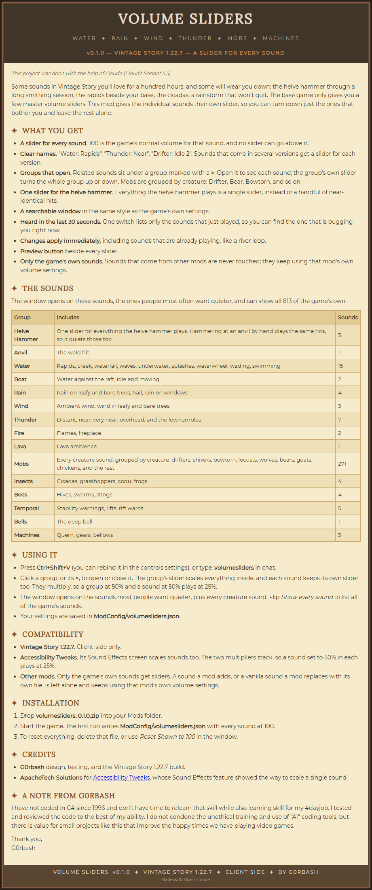

<b>Text version</b> (the same content as the image above)

*This project was done with the help of Claude (Claude Sonnet 5.5).*

Some sounds in Vintage Story you'll love for a hundred hours, and some will wear you down: the helve hammer through a long smithing session, the rapids beside your base, the cicadas, a rainstorm that won't quit. The base game only gives you a few master volume sliders. This mod gives the individual sounds their own slider, so you can turn down just the ones that bother you and leave the rest alone.

### What You Get

- **A slider for every sound.** 100 is the game's normal volume for that sound, and no slider can go above it.
- **Clear names.** "Water: Rapids", "Thunder: Near", "Drifter: Idle 2". Sounds that come in several versions get a slider for each version.
- **Groups that open.** Related sounds sit under a group marked with a **&gt;**. Open it to see each sound; the group's own slider turns the whole group up or down. Mobs are grouped by creature: Drifter, Bear, Bowtorn, and so on.
- **One slider for the helve hammer.** Everything the helve hammer plays is a single slider, instead of a handful of near-identical hits.
- **A searchable window** in the same style as the game's own settings.
- **Heard in the last 30 seconds.** One switch lists only the sounds that just played, so you can find the one that is bugging you right now.
- **Changes apply immediately**, including sounds that are already playing, like a river loop.
- **Preview button** beside every slider.
- **Only the game's own sounds.** Sounds that come from other mods are never touched; they keep using that mod's own volume settings.

### The Sounds

The window opens on these sounds, the ones people most often want quieter, and can show all 813 of the game's own.

| Group | Includes | Sounds |
|---|---|---|
| **Helve Hammer** | One slider for everything the helve hammer plays. Hammering at an anvil by hand plays the same hits, so it quiets those too. | 3 |
| **Anvil** | The weld hit | 1 |
| **Water** | Rapids, creek, waterfall, waves, underwater, splashes, waterwheel, wading, swimming | 15 |
| **Boat** | Water against the raft, idle and moving | 2 |
| **Rain** | Rain on leafy and bare trees, hail, rain on windows | 4 |
| **Wind** | Ambient wind, wind in leafy and bare trees | 3 |
| **Thunder** | Distant, near, very near, overhead, and the low rumbles | 7 |
| **Fire** | Flames, fireplace | 2 |
| **Lava** | Lava ambience | 1 |
| **Mobs** | Every creature sound, grouped by creature: drifters, shivers, bowtorn, locusts, wolves, bears, goats, chickens, and the rest | 271 |
| **Insects** | Cicadas, grasshoppers, coqui frogs | 4 |
| **Bees** | Hives, swarms, stings | 4 |
| **Temporal** | Stability warnings, rifts, rift wards | 5 |
| **Bells** | The deep bell | 1 |
| **Machines** | Quern, gears, bellows | 3 |

### Using It

- Press **Ctrl+Shift+V** (you can rebind it in the controls settings), or type **.volumesliders** in chat.
- Click a group, or its **&gt;**, to open or close it. The group's slider scales everything inside, and each sound keeps its own slider too. They multiply, so a group at 50% and a sound at 50% plays at 25%.
- The window opens on the sounds most people want quieter, plus every creature sound. Flip *Show every sound* to list all of the game's sounds.
- Your settings are saved in **ModConfig/volumesliders.json**.

### Compatibility

- **Vintage Story 1.22.7.** Client-side only.
- **Accessibility Tweaks.** Its Sound Effects screen scales sounds too. The two multipliers stack, so a sound set to 50% in each plays at 25%.
- **Other mods.** Only the game's own sounds get sliders. A sound a mod adds, or a vanilla sound a mod replaces with its own file, is left alone and keeps using that mod's own volume settings.

### Installation

1. Drop **volumesliders_0.1.0.zip** into your Mods folder.
2. Start the game. The first run writes **ModConfig/volumesliders.json** with every sound at 100.
3. To reset everything, delete that file, or use *Reset Shown to 100* in the window.

### Credits

- **G0rbash** design, testing, and the Vintage Story 1.22.7 build.
- **ApacheTech Solutions** for [Accessibility Tweaks](https://mods.vintagestory.at/accessibilitytweaks), whose Sound Effects feature showed the way to scale a single sound.

### A Note from G0rbash

I have not coded in C# since 1996 and don't have time to relearn that skill while also learning skill for my #dayjob. I tested and reviewed the code to the best of my ability. I do not condone the unethical training and use of "AI" coding tools, but there is value for small projects like this that improve the happy times we have playing video games.

Thank you,  
G0rbash

**Links:** [Accessibility Tweaks](https://mods.vintagestory.at/accessibilitytweaks)

**Building from source:** see [BUILDING.md](BUILDING.md).
