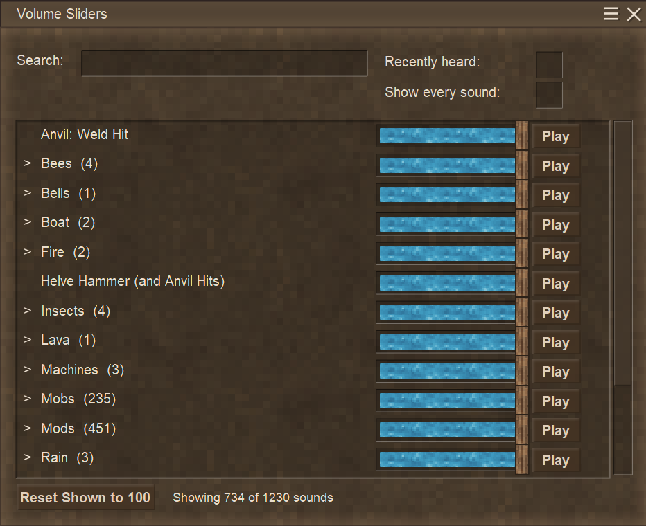
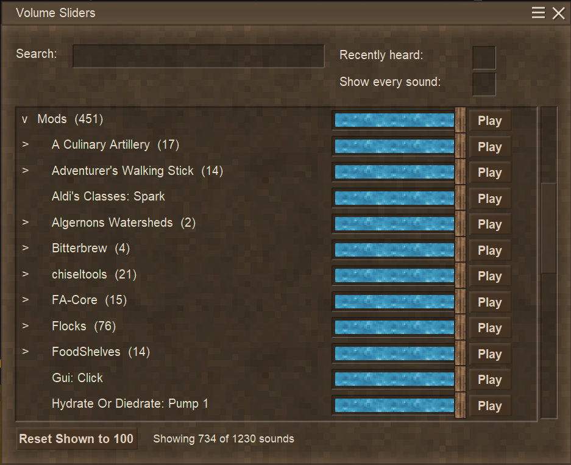

# Volume Sliders

Version 0.1.4 · Vintage Story 1.22.7 · client side

*This project was done with the help of Claude (Claude Sonnet 5.5).*

Volume Sliders adds a volume slider for each sound in Vintage Story. The base game only has a few master volume sliders. With this mod you can turn down a single sound, such as the helve hammer, the rapids, the cicadas or the rain, and leave everything else as it is.

<b>Screenshots</b>

*The window, opened with Ctrl+Shift+V. A group marked with > opens to show its sounds.*

*Sounds from other mods are listed under Mods, one group per mod.*

## What you get

- A slider for every sound, from 0 to 100. 100 is the game's normal volume; no slider can go above it.
- Sounds are listed in groups (Water, Mobs, Armor and so on). Click a group, or its **>**, to open it. A group's slider scales everything inside it.
- Some near-identical sounds share one slider: Bells (the Bell mob and its Deep, Nightmare and Tainted versions), NPC Voices, each type of armor, and the Anvil group (Helve Hammer and Hand Hammer).
- A search box, and a *Recently heard* switch that lists the sounds played in the last 30 seconds, for finding a sound you can't name.
- A Play button beside every slider.
- Changes apply immediately, including to loops that are already playing, such as a river.
- Sounds added by other mods are listed under **Mods**, grouped by mod. When a mod replaces one of the game's sounds, that slider shows the mod's name.

## The sounds

The window opens on these sounds. Everything else is available with *Show every sound*, or by searching: Player, Combat, Crafting & Activities, Walk, Music and Miscellaneous. The mini Bell, Charlemange, is under Mobs.

- **Anvil**: *Helve Hammer* and *Hand Hammer* have separate sliders. The game plays the same sound file for both, with the helve hammer at a much lower pitch, so the mod tells them apart by pitch. Hand Hammer also covers the weld hit. Placing or breaking an anvil is a different sound (Miscellaneous > Block).
- **Water**: Rapids, creek, waterfall, waves, underwater, splashes, waterwheel, wading, swimming
- **Boat**: Water against the raft, idle and moving
- **Rain**: Rain on leafy and bare trees, hail, rain on windows
- **Wind**: Ambient wind, wind in leafy and bare trees
- **Thunder**: Distant, near, very near, overhead, and the low rumbles
- **Fire**: Flames, fireplace
- **Lava**: Lava ambience
- **Insects**: Cicadas, grasshoppers, coqui frogs
- **Bees**: Hives, swarms, stings
- **Mobs**: Creature sounds, grouped by creature: drifters, shivers, bowtorn, locusts, wolves, bears, goats, chickens and the rest. Bells is one slider for the Bell mob, including its deep bell and its Deep, Nightmare and Tainted versions.
- **NPC Voices**: Speech from traders and villagers, on one slider.
- **Armor**: One slider each for Brigandine, Chain, Leather, Plate and Scale, and an Armor slider for all of them.
- **Temporal**: Stability warnings, rifts, rift wards
- **Machines**: Quern, gears, bellows
- **Mods**: Sounds added by other mods, grouped by mod. Salty's Temporal Symphony is one example.

## Using it

- Open the window with **Ctrl+Shift+V** (rebindable in the controls settings) or the chat command **.volumesliders**.
- A group's slider and the sliders inside it multiply: a group at 50% and a sound at 50% plays at 25%.
- The window opens on the sounds listed below plus creature sounds. *Show every sound* lists all of them. *Recently heard* lists whatever just played, whether it is on the default list or not.
- Settings are saved in **ModConfig/volumesliders.json**.

## Compatibility

- **Vintage Story 1.22.7.** Client-side only.
- **Accessibility Tweaks.** Its Sound Effects screen also scales sounds. Both apply, so a sound set to 50% in each plays at 25%.
- **Other mods.** Their sounds get sliders under Mods. A mod's own volume setting still applies on top of these sliders. A mod that plays sound through its own audio code instead of the game's sound engine may not respond.

## Installation

1. Put **volumesliders_0.1.4.zip** in your Mods folder.
2. Start the game. The first run creates **ModConfig/volumesliders.json**.
3. To reset everything, delete that file, or use *Reset Shown to 100* in the window.

## License

Volume Sliders follows the [Vintage Story Mod DB terms](https://mods.vintagestory.at/terms): it is free to download and use, and it may not be reuploaded, modified or not, without the author's approval. The full text is in [LICENSE](LICENSE).

## A note from G0rbash
I have not coded in C# since 1996, and json is just pure black magic I don't have time to relearn that skill while also learning skills for my #dayjob.
I tested and reviewed the code to the best of my ability.
I do not condone the unethical training and use of "AI" coding tools, but there is value for small projects like this that improve the happy times we have playing video games.
All code is available for review on the GitHub page.

Thank you,  
G0rbash

---

Building from source: see [BUILDING.md](BUILDING.md).
